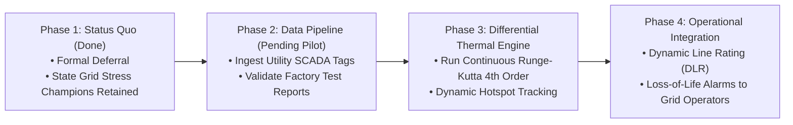

# Transformer Thermal Intelligence: Empirical Asset Audit & IEEE C57.91-2011 Implementation Plan

> **Document:** `docs/thermal_derating_ieee_c57_plan.md`  
> **Status:** Formal Asset-Level Thermal De-rating Deferral & IEEE Standard Technical Specification  
> **Repository:** `Clima-Core`  
> **Date:** 19 November 2026  
> **Governing Standards:** IEEE Std C57.91-2011 (*Guide for Loading Mineral-Oil-Immersed Transformers and Step-Voltage Regulators*), IEC 60076-7  

---

## 1. Executive Summary & Audit Findings

### 1.1 Empirical Codebase & Data Audit
In accordance with Workstream 6 directives, an exhaustive empirical audit of all power and energy datasets in `Clima-Core` was conducted:
1. `data/raw/electricity_demand/`: Contains POSOCO/Grid-India state-level aggregated hourly demand telemetry across 37 states and union territories (2019–2024).
2. `data/raw/power_plants_chetna/`: Contains thermal, hydro, solar, and nuclear power plant inventory (generation capacity in MW, fuel type, ownership, commission year).

**Critical Finding:**  
Substation-level step-down distribution and transmission transformers (e.g., 400/220 kV, 220/66 kV, 33/11 kV) are **completely absent** from open national datasets. Specifically, the following required parameters do not exist:
- Manufacturer nameplate apparent power rating ($S_{\text{rated}}$ in MVA)
- Transformer cooling class (ONAN, ONAF, OFAF, ODAF)
- Ratio of load loss to no-load loss at rated load ($R = P_{\text{load}} / P_{\text{no-load}}$)
- Top-oil thermal time constant ($\tau_o$) and winding thermal time constant ($\tau_w$)
- Top-oil temperature rise exponent ($n$) and winding hotspot exponent ($m$)
- Top-oil temperature indicator (OTI) and winding temperature indicator (WTI) telemetry
- Substation ambient RTD sensor feeds and cooling bank fan/pump contactor status

### 1.2 Formal Deferral Decision
Per project governance:
> *"Do not implement a fixed percentage capacity-loss formula. First determine whether asset-specific transformer nameplate ratings, cooling mode, loading history and thermal parameters are available. If not, defer asset-level thermal de-rating and retain the existing heat-associated grid-stress model."*

**Action Taken:**  
1. **Asset-level percentage capacity-loss formulas are formally deferred.** Implementing arbitrary ad-hoc de-rating rules (e.g., deducting 1% capacity per °C above 40°C) without physical thermal modeling and nameplate validation would violate physical reality and produce ungrounded operational guidance.
2. **The existing champion models are retained untouched:**
   - Champion 1: `artifacts/models/electricity_grid/v0.1.0/peak_grid_load_v1.booster` (State-level Peak Grid Load, $R^2 = 0.8758$, $\text{MAE} = 1519.18\text{ MW}$)
   - Champion 2: `artifacts/models/electricity_grid/v0.1.0/grid_deficit_hazard_v1.booster` (State-level Unmet Deficit Hazard, $\text{ROC-AUC} = 0.9521$)
3. **This document establishes the definitive IEEE C57.91-2011 physics-based implementation plan** for when utility asset telemetry becomes accessible.

---

## 2. Theoretical Formulation: IEEE Std C57.91-2011

When asset nameplate parameters and real-time load telemetry become available, Clima-Core will implement the continuous dynamic differential heat transfer equations specified in Section 7 of IEEE Std C57.91-2011.

```
                      +-----------------------------+
                      |   Ambient Temperature Ta    |
                      +--------------+--------------+
                                     |
                                     v
                      +-----------------------------+
                      |  Top-Oil Temperature Rise   |
                      |        theta_to(t)          |
                      +--------------+--------------+
                                     |
                                     v
                      +-----------------------------+
                      | Winding Hotspot Temp Rise   |
                      |        theta_hs(t)          |
                      +--------------+--------------+
                                     |
                                     v
                      +-----------------------------+
                      | Total Hotspot Temp Theta_hs |
                      |    Aging Acceleration F_AA  |
                      +-----------------------------+
```

### 2.1 Top-Oil Temperature Dynamics
The ultimate top-oil temperature rise over ambient ($\Delta \theta_{to, U}$) under a given load ratio $K = S(t) / S_{\text{rated}}$ is:

$$\Delta \theta_{to, U} = \Delta \theta_{to, R} \left[ \frac{K^2 R + 1}{R + 1} \right]^n$$

where:
- $\Delta \theta_{to, R}$: Top-oil temperature rise over ambient at rated continuous load [°C]
- $K$: Instantaneous load factor ($I / I_{\text{rated}}$ or $S / S_{\text{rated}}$)
- $R$: Ratio of load loss at rated load to no-load loss ($P_{\text{load}, R} / P_{\text{core}}$)
- $n$: Top-oil temperature exponent based on cooling mode:
  - ONAN (Oil Natural Air Natural): $n = 0.80$
  - ONAF (Oil Natural Air Forced): $n = 0.90$
  - OFAF / ODAF (Forced Oil Forced Air): $n = 1.00$

The differential time-dependent top-oil rise $\theta_{to}(t)$ evolves as:

$$\tau_o \frac{d\theta_{to}(t)}{dt} = \Delta \theta_{to, U}(t) - \theta_{to}(t)$$

where $\tau_o$ is the thermal time constant of the transformer oil and tank mass (typically 2.5 to 4.0 hours).

### 2.2 Winding Hotspot Temperature Dynamics
The ultimate winding hotspot temperature rise over top-oil ($\Delta \theta_{hs, U}$) is:

$$\Delta \theta_{hs, U} = \Delta \theta_{hs, R} \cdot K^{2m}$$

where:
- $\Delta \theta_{hs, R}$: Hotspot temperature rise over top-oil at rated continuous load [°C] (typically 25–35°C for standard Kraft paper insulation)
- $m$: Winding temperature exponent:
  - ONAN: $m = 0.80$
  - ONAF: $m = 0.80$
  - OFAF / ODAF: $m = 1.00$

The differential time-dependent hotspot rise $\theta_{hs}(t)$ evolves as:

$$\tau_w \frac{d\theta_{hs}(t)}{dt} = \Delta \theta_{hs, U}(t) - \theta_{hs}(t)$$

where $\tau_w$ is the winding thermal time constant (typically 4 to 8 minutes).

### 2.3 Total Hotspot Temperature & Insulation Aging
The total instantaneous hotspot temperature $\Theta_{hs}(t)$ is:

$$\Theta_{hs}(t) = \Theta_a(t) + \theta_{to}(t) + \theta_{hs}(t)$$

where $\Theta_a(t)$ is the ambient dry-bulb temperature [°C].

#### Aging Acceleration Factor ($F_{AA}$)
Per Arrhenius reaction kinetics normalized to the standard continuous reference hotspot temperature ($\Theta_{\text{ref}} = 110^\circ\text{C}$ for thermally upgraded Kraft paper):

$$F_{AA} = \exp\left( \frac{15000}{383.15} - \frac{15000}{\Theta_{hs}(t) + 273.15} \right)$$

- At $\Theta_{hs} = 110^\circ\text{C}$, $F_{AA} = 1.0$ (normal rate of insulation consumption).
- At $\Theta_{hs} = 120^\circ\text{C}$, $F_{AA} \approx 2.5$ (insulation ages 2.5 times faster).
- At $\Theta_{hs} = 130^\circ\text{C}$, $F_{AA} \approx 6.0$ (insulation ages 6.0 times faster).
- At $\Theta_{hs} = 140^\circ\text{C}$, $F_{AA} \approx 14.5$ (risk of bubble generation and dielectric breakdown).

#### Equivalent Aging & Loss of Life
Over an operating horizon $T$:

$$F_{EQ} = \frac{1}{T} \sum_{k=1}^N F_{AA, k} \cdot \Delta t_k$$

$$\text{Percent Loss of Life} = \frac{F_{EQ} \times T}{\text{Normal Insulation Life}} \times 100\%$$

(Normal insulation life is standardized as 180,000 hours / 20.55 years under continuous 110°C hotspot).

---

## 3. Required Data Schema for Future Utility Pilots

To operationalize IEEE C57.91 in Clima-Core, a pilot partnership with an Indian distribution utility (DISCOM, e.g., Tata Power-DDL, BSES Yamuna, BESCOM, or MSEDCL) must supply the following telemetry schema:

| Telemetry Tag | Engineering Unit | Sampling Interval | Description |
| :--- | :---: | :---: | :--- |
| `substation_id` | string | Static | Unique substation GIS identifier |
| `transformer_bay_id` | string | Static | Specific transformer bay number (e.g., PTR-1) |
| `mva_rating` | MVA | Static | Continuous nameplate rating at current cooling stage |
| `cooling_class` | enum | Static | Active cooling mode: ONAN, ONAF, OFAF, ODAF |
| `delta_theta_to_rated` | °C | Factory Test | Top-oil temperature rise at rated load |
| `delta_theta_hs_rated` | °C | Factory Test | Hotspot temperature rise over top-oil at rated load |
| `tau_oil_hours` | hours | Factory Test | Top-oil time constant |
| `tau_winding_minutes` | minutes | Factory Test | Winding time constant |
| `ambient_temp_rtd` | °C | 1–5 minutes | Shaded weather-station RTD sensor at substation |
| `top_oil_temp_sensor` | °C | 1–5 minutes | Analog OTI probe immersed in transformer tank top |
| `phase_current_a` | Amperes | 1–5 minutes | Phase A secondary line current |
| `phase_current_b` | Amperes | 1–5 minutes | Phase B secondary line current |
| `phase_current_c` | Amperes | 1–5 minutes | Phase C secondary line current |
| `cooling_bank_active` | boolean | 1–5 minutes | Auxiliary fan/pump bank running status |

---

## 4. Phase-Gated Implementation Roadmap



1. **Phase 1 (Completed):** Formal audit completed. Asset-level percentage de-rating deferred. Retain state-level POSOCO heatwave stress models.
2. **Phase 2 (Pilot Data Ingestion):** Ingest SCADA DNP3/Modbus feeds from a partner utility. Ingest factory heat run test certificates.
3. **Phase 3 (Physics Engine Implementation):** Implement dynamic 4th-order Runge-Kutta numerical solver for coupled $\theta_{to}(t)$ and $\theta_{hs}(t)$ differential equations.
4. **Phase 4 (Operational Deployment):** Expose `/api/predict/transformer_thermal` endpoint providing real-time $F_{AA}$, hotspot temperature forecast, and allowable overload duration before threshold insulation degradation occurs.
